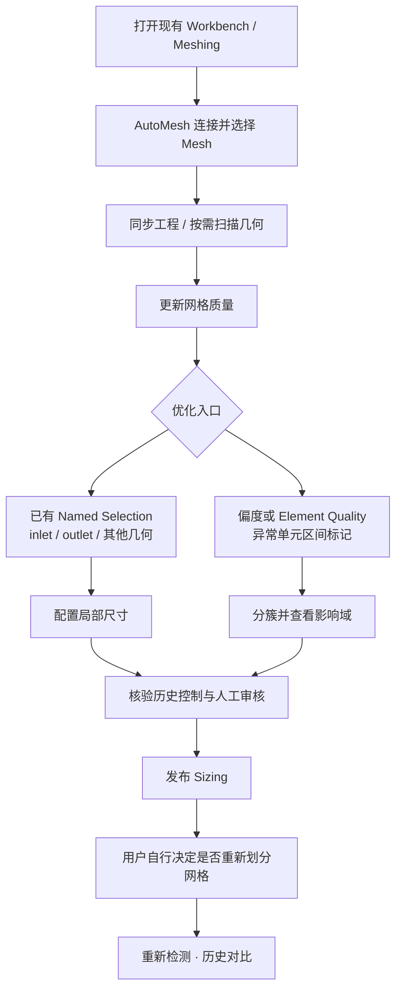

# AutoMesh R8.1

### 让 ANSYS 网格质量诊断与局部优化更简单

**连接已有工程 · 找到问题单元 · 审核局部 Sizing · 对比优化结果**

适用于 **Windows x64 · ANSYS Workbench / Meshing 2024 R2**

**R8.1 RC · 发布候选版 · Windows / ANSYS 实机待验收**

[**获取 Windows 程序**](app/AutoMesh.exe)　·　[**新手快速上手**](docs/GETTING_STARTED.md)　·　[**查看源码**](source/)

---

## 第一次使用？从这里开始

**AutoMesh 是什么？** 它是一款连接**你已经打开的 ANSYS Workbench / Meshing** 的辅助工具：检查现有网格质量、定位异常单元、建议局部网格尺寸、人工审核并发布 Sizing，最后比较优化前后的质量。**不需要为了使用它重新建立工程。**

### 5 步开始使用

| 步骤 | 要做什么 | 在哪里操作 |
|:---:|---|---|
| **01** | 打开已有 Workbench 工程和目标 Meshing 编辑器 | ANSYS |
| **02** | 连接当前工程，选择正确的 Mesh 系统 | **连接工程** |
| **03** | 同步工程，点击 **更新质量** 查看网格指标 | 顶部工具栏 / **质量报告** |
| **04** | 选择命名组尺寸，或标记高偏度 / 低 Element Quality 单元 | **局部细化** / **质量报告** |
| **05** | 检查影响域后人工审核 Sizing；需要时自行重划网格，再做前后对比 | **候选审核** / **质量分析** |

> [!TIP]
> **第一次只想看看软件是否可用？** 先做到第 03 步即可。查看已有网格质量不等于发布 Sizing，也不会自动 GenerateMesh。

[**阅读带操作说明的新手指南 →**](docs/GETTING_STARTED.md)

## 你想做哪一种优化？

<table>
<tr>
<td width="50%" valign="top">

### A · 按几何区域设置尺寸

**适用：** `inlet`、`outlet`、孔、挡板、晶圆面等已命名的区域。

**操作路径**

`连接工程` → `局部细化` → `核对命名组` → `设置尺寸` → `审核发布`

- 手动命名与自动识别的区域都可参与
- 入口、出口可分别设置，不强制统一尺寸
- 已有手动 Sizing 会进行覆盖及冲突检查

</td>
<td width="50%" valign="top">

### B · 按劣质单元定位细化

**适用：** 偏度过大、Element Quality 过低、小凸起附近的畸形单元。

**操作路径**

`更新质量` → `标记区间` → `生成局部方案` → `查看影响域` → `人工审核`

- 可自定义 Skewness / Element Quality 区间
- 对异常区域分簇，并检查历史 Sizing
- 只发布通过人工核查的候选

</td>
</tr>
</table>

## 一张图看懂工作流程

> [!IMPORTANT]
> AutoMesh 的**发布 Sizing 不会自动 GenerateMesh**。已有历史 Sizing、几何身份检查、人工确认和重复影响域保护仍需遵守。累计预算 **120000 是预警值，不是网格单元数硬上限**；超阈值需额外确认。

## 六个页面分别负责什么？

| 页面 | 主要用途 |
|---|---|
| **概览** | 一眼查看工程连接、网格质量与任务状态 |
| **连接工程** | 连接已有 Workbench、选择 Mesh 系统 |
| **局部细化** | 几何扫描、命名组尺寸及 Sizing 管理 |
| **质量报告** | 查看质量、标记异常单元、生成局部方案 |
| **质量分析** | 多轮历史、优化前后对比、统计及导出 |
| **设置与维护** | 诊断、数据目录与维护操作 |

### 这些指标怎么看？

| 质量指标 | 越好的一侧 | 能帮你判断什么 |
|---|---|---|
| **Skewness 偏度** | 越接近 **0** 越好 | 识别严重畸变单元 |
| **Element Quality** | 越接近 **1** 越好 | 判断单元形状质量，需兼看最小与平均 |
| **Orthogonal Quality** | 越接近 **1** 越好 | 辅助评价 CFD 网格正交性 |
| **P95 / 高偏度数量** | 结合分布判断 | 查看最差的一批单元是否真的减少 |

> 某些原生 ACT 质量接口尚待实机验证。数值显示“未取得”表示没有可靠数据，**不代表 0**；不会用偏度或平均值推算其他真实指标。

## 下载、更新与源码

| 你需要 | 入口 |
|---|---|
| **直接使用 Windows 程序** | [AutoMesh.exe](app/AutoMesh.exe) |
| **查看完整 R8.1 Go / Python / ACT 源码** | [source/](source/) |
| **保存本次原始源码与 EXE ZIP** | [R8.1 完整归档](releases/AutoMesh_R8_1_RC_20261109_B4E98F95E6AEB8E68B8AE5BA85E5A3Sizing_AEE6B4BAE781.zip) |
| **了解当前测试与待验收项** | [开发检查点](docs/releases/R8.1_RC_20261109_质量数据与手动出入口Sizing_检查点.md) |
| **检查文件完整性** | [SHA-256 清单](SHA256SUMS.txt) |

**升级提示：** 关闭旧 AutoMesh 后更新 EXE，**不要删除** `C:\ProgramData\AutoMesh2024R2\Data`。这里可能保存历史任务、质量快照和 Sizing 记录。

<strong>为什么有些按钮是灰色、为什么质量数据未取得？</strong>

请先检查工程身份、完整几何扫描、目标勾选、已有 Sizing 冲突、人工审核和任务状态。未取得的质量指标可能涉及 Meshing ACT 接口限制。详细排查见 [新手指南 · 常见问题](docs/GETTING_STARTED.md#5-常见问题)。

<strong>已经有历史 Sizing，还能继续优化吗？</strong>

可以继续诊断和提交候选，但要核对历史影响域、几何身份及空间重叠。每批最多 6 个；累计资源代理超过建议阈值时需要额外人工确认。预算代理不是实际单元数，也不是内存预测。

---

**版本与验收：** 当前代码为 R8.1 RC（2026-11-09）。已有离线定向测试和 Windows GUI 交叉编译记录；Windows 原生六页面、ANSYS ACT 质量数据采集和 inlet/outlet Sizing 的实际效果仍待实机验收。仓库旧版本可从 [Git 历史](../../commits/main) 找回。本仓库未附开源许可证。
