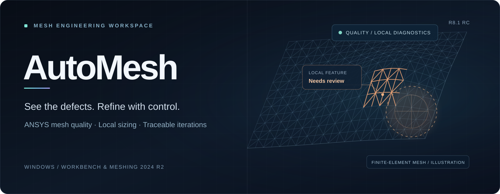

<div align="center">
  

  <br />

  <p><strong>让网格优化从反复试错，变成可追踪的工程流程。</strong></p>
  <p>连接已有 ANSYS 工程，定位劣质单元，审核局部网格控制，记录每一轮优化的质量变化。</p>

  <p>
    
    
    
  </p>

  <p>
    <a href="app/AutoMesh.exe"><strong>获取 Windows 程序</strong></a>
    &nbsp;&nbsp; · &nbsp;&nbsp;
    <a href="docs/GETTING_STARTED.md"><strong>5 分钟快速上手</strong></a>
    &nbsp;&nbsp; · &nbsp;&nbsp;
    <a href="source/"><strong>浏览源码</strong></a>
  </p>
</div>

---

## Overview · 项目简介

**AutoMesh** 是一款面向 **ANSYS Workbench / Meshing** 的 Windows 原生辅助工具。它连接已经打开的工程，将质量检测、异常定位、局部尺寸建议、人工审核和历史对比组织到一套工作流中。

它**不是另一个网格生成器**：AutoMesh 负责帮助你决定 *哪里需要调整、为什么调整、调整后是否改善*；是否重新划分网格，仍由用户在 Meshing 中决定。

## Workflow · 从发现问题到验证改善

```text
01  CONNECT        02  DIAGNOSE        03  REFINE         04  REVIEW        05  COMPARE
    连接现有工程   →   读取真实网格质量   →   定位局部问题   →   人工审核 Sizing   →   历史前后对比
```

| 工作阶段 | AutoMesh 做什么 |
|---|---|
| **Connect** | 复用现有 Workbench / Meshing，会话与 Mesh 身份同步 |
| **Diagnose** | 读取 Skewness、Element Quality 等可用的原生质量指标 |
| **Refine** | 标记异常单元、生成空间分簇与局部影响域建议 |
| **Review** | 检查已有 Sizing、作用域和风险，人工确认后发布控制 |
| **Compare** | 保存任务快照，查看质量趋势、优化前后差异并导出报告 |

> **最短路径：** 首次使用只需要打开已有 Workbench 工程 → 启动 AutoMesh → 连接 Mesh → 点击 **更新质量**。不必一开始就发布任何 Sizing。

## Capabilities · 核心能力

### 01 / 识别真正需要优化的区域

针对 **Skewness（偏度）** 和 **Element Quality（单元质量）**，支持自定义区间标记、异常单元分簇、局部影响域及小特征几何诊断。遇到没有可靠数据的质量指标，会标明“未取得”及其来源限制，而不是估算。

### 02 / 让局部 Sizing 可控、可核验

手动命名的 **`inlet` / `outlet`** 与自动识别的 Named Selection 均可参与尺寸推荐与发布。入口和出口可使用不同尺寸；现有手动 Sizing、历史控制、重叠作用域和失效引用需要在发布前核对。

### 03 / 每轮修改都有迹可循

统一查看工程、任务、网格质量和历史快照。分析中心可对比优化前后的最大偏度、最小及平均 Element Quality 等真实指标；几何身份或采集口径无法核验时，明确区分正式对比与参考差值。

## Quick start · 现在开始

| 步骤 | 操作 | 位置 |
|:---:|---|---|
| **1** | 打开已有 Workbench 工程及目标 Meshing 编辑器 | ANSYS |
| **2** | 启动 AutoMesh，连接现有会话并选择 Mesh 系统 | **连接工程** |
| **3** | 同步工程，点击 **更新质量**，核对质量与数据来源 | 顶部工具栏 / **质量报告** |
| **4** | 对已命名的区域设置尺寸，或标记高偏度 / 低单元质量区域 | **局部细化** / **质量报告** |
| **5** | 查看影响域、审核 Sizing；如有重划网格，再比较结果 | **候选审核** / **质量分析** |

[**打开完整新手指南 →**](docs/GETTING_STARTED.md)

<details>
<summary><strong>六个页面如何分工？</strong></summary>

| 页面 | 负责什么 |
|---|---|
| 概览 | 工程状态、网格质量和任务摘要 |
| 连接工程 | 连接现有 Workbench、选择目标 Mesh |
| 局部细化 | 完整几何扫描、Named Selection、尺寸与 Sizing |
| 质量报告 | 质量读取、异常单元标记、生成局部方案 |
| 质量分析 | 多轮快照、趋势、前后对比与导出 |
| 设置与维护 | 运行诊断、数据目录与维护 |

</details>

<details>
<summary><strong>两种局部优化方式有什么区别？</strong></summary>

**几何区域路线：** 已有 `inlet`、`outlet`、孔、晶圆面等 Named Selection → 核对覆盖 → 设置单项/整组尺寸 → 审核发布。

**质量缺陷路线：** 偏度或 Element Quality 区间标记 → 局部分簇 → 影响域检查 → 候选勾选 → 人工审核发布。

后者并不意味着劣质单元一定适合继续细化；尖角、短边和薄壁区域仍需检查实际几何与网格方法。

</details>

## Principles · 工程安全边界

> [!IMPORTANT]
> **发布 Sizing ≠ 自动重新生成网格。** AutoMesh 不应自动执行 `GenerateMesh`，也不应未经确认删除、覆盖或停用已有 Sizing。

- **复用现有模型：** 不自动新建 Workbench 工程，不随意重扫有效几何。
- **人工审核优先：** 候选区域、历史身份、几何作用域和近重合控制均需通过核验；单批最多发布 6 个。
- **资源预警而非死板拦截：** 累计预算代理 `120000` 为提醒阈值，超过时需额外确认；它不是实际单元数或内存限制。
- **升级不丢历史：** 只替换程序，保留 `C:\ProgramData\AutoMesh2024R2\Data` 中的质量快照和任务记录。

## Get the project · 下载与开发

| 资源 | 说明 |
|---|---|
| **[AutoMesh.exe](app/AutoMesh.exe)** | 当前 Windows x64 GUI 发布候选程序 |
| **[完整源码](source/)** | Go 原生桌面 UI、Python 桥接、Meshing ACT Worker 与测试 |
| **[R8.1 源码归档 ZIP](releases/AutoMesh_R8_1_RC_20261109_B4E98F95E6AEB8E68B8AE5BA85E5A3Sizing_AEE6B4BAE781.zip)** | 本轮已校验的原始归档 |
| **[新手指南](docs/GETTING_STARTED.md)** | 首次连接、两条优化路线、常见问题 |
| **[开发检查点](docs/releases/R8.1_RC_20261109_质量数据与手动出入口Sizing_检查点.md)** | 本轮变更、定向测试与待验证项目 |
| **[SHA-256 清单](SHA256SUMS.txt)** | 仓库文件完整性核验 |

<details>
<summary><strong>技术架构 / Technical stack</strong></summary>

```text
AutoMesh.exe           Windows 原生 UI · Go
      │
      ▼
Python / PyWorkbench   连接现有 Workbench 脚本会话
      │
      ▼
Meshing ACT Worker     真实网格读取 · 标记 · 分簇 · 安全审核
      │
      ▼
ANSYS Named Selection / Sizing
      │
      ▼
Job receipt · Quality history · Reports
```

</details>

---

<p align="center">
  <strong>R8.1 RC · 2026-11-09</strong><br />
  <sub>当前为发布候选版。离线定向测试和 Windows GUI 交叉编译已有记录；Windows 六页面、ANSYS ACT 原生质量数据与 inlet/outlet Sizing 的端到端实机验收尚未完成。</sub><br />
  <sub>仓库目前未提供开源许可证。历史版本可通过 <a href="https://github.com/1463503175-pixel/AutoMesh/commits/main/">Git 提交记录</a> 查找。</sub>
</p>
